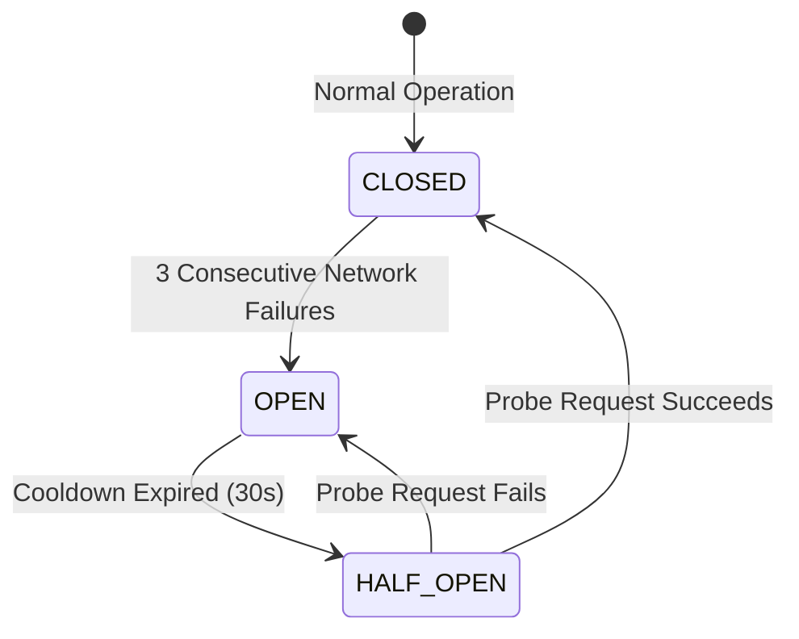

# Operational Runbook: Upstream API Degradation & Network Resilience

**Severity**: P1 / P2  
**Target System**: Fomo Weather & Geocoding Integrations  
**Dependencies**: Open-Meteo REST API (`api.open-meteo.com`, `geocoding-api.open-meteo.com`)

---

## 1. Overview
Fomo consumes external meteorological data and geocoding services from Open-Meteo. When upstream endpoints experience elevated HTTP 5xx errors, packet loss, DNS outages, or latency spikes, Fomo must gracefully degrade without freezing or crashing the client application.

---

## 2. Detection & Symptoms
- **Error Budget Consumption**: Upstream network error rate exceeds 5.0% over 5 minutes.
- **Circuit Breaker Engagement**: `ResilienceCircuitBreaker` transitions from `CLOSED` to `OPEN`.
- **User Experience**: Application displays cached weather data with an indicator badge ("Offline / Cached Data") rather than a blank or broken screen.

---

## 3. Circuit Breaker Behavior & Architecture



When Circuit Breaker is `OPEN`:
1. All outbound HTTP network requests fail fast immediately without occupying thread pool executors or consuming mobile battery.
2. `OfflineFirstWeatherRepository` automatically routes queries to L1 LRU Memory cache and L2 Room local SQLite storage.
3. User sees the last known valid forecast with freshness timestamp.

---

## 4. Triage & Operational Actions

### Step 1: Verify Upstream Service Health
Execute health probes against Open-Meteo public status:
```bash
# Check Geocoding API response time and status code
curl -I -s -w "HTTP: %{http_code} | Total: %{time_total}s\n" "https://geocoding-api.open-meteo.com/v1/search?name=London&count=1"

# Check Weather Forecast API
curl -I -s -w "HTTP: %{http_code} | Total: %{time_total}s\n" "https://api.open-meteo.com/v1/forecast?latitude=51.50&longitude=-0.12&current=temperature_2m"
```

### Step 2: Rate Limiting & Throttling Verification
If Open-Meteo returns HTTP 429 Too Many Requests:
1. Verify device request frequency. Ensure `ITEM_VIEW_CACHE_SIZE` and request debouncing (300ms on search) are active.
2. Confirm client HTTP disk cache (`ApiClient.buildOkHttpClient(..., cacheDir, 10MB)`) is responding with HTTP 304 Not Modified or cache hits.

### Step 3: Temporary Fallback Strategies
If upstream outage persists > 2 hours:
1. Increase local cache TTL from 30 minutes to 6 hours in `WeatherRepository` configuration.
2. Notify users via in-app banner ("Meteorological satellite feed experiencing upstream delays; displaying local historical telemetry").

---

## 5. Post-Incident Review Checklist
- [ ] Upstream SLA tracking logged in quarterly incident summary.
- [ ] Confirm `ResilienceCircuitBreaker` reset cleanly to `CLOSED` after upstream recovery.
- [ ] Review cache hit ratio (`AppMetricsCollector`) during outage window to ensure L2 persistence shielded >= 90% of requests.

