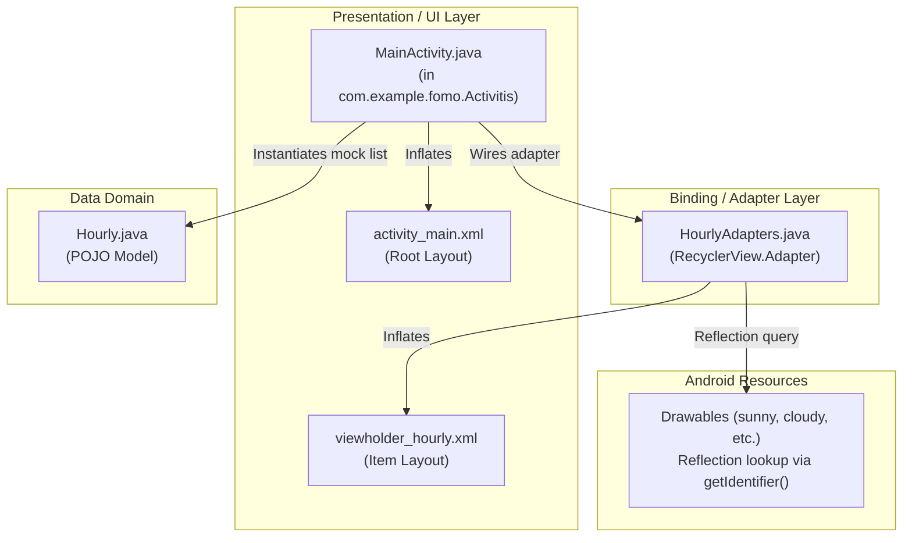

# 02 — Architecture Assessment & System Design

## 1. Current Architecture Topology

The application currently operates as an unpatterned, monolithic single-Activity prototype.



### Critical Architectural Weaknesses
1. **Zero Layer Separation**: `MainActivity` serves as view, mock data store, controller, and layout configurator simultaneously.
2. **Package Misnaming & Inconsistency**: Package name contains a spelling error (`Activitis` instead of `activities`) and uses PascalCase directory names (`Activitis`, `Adapters`, `Domains`), violating standard Java/Android package naming conventions (`lowercase.only`).
3. **No Reactive Data Flow**: Zero observable state (no LiveData, StateFlow, or RxJava). The UI cannot react to asynchronous updates.
4. **Fragile Reflection Coupling**: `HourlyAdapters` uses runtime string reflection (`Resources.getIdentifier`) to map weather strings to drawable IDs, bypassing compiler type safety and causing silent runtime rendering failures when strings mismatch (e.g. `"sun"` vs `"sunny.png"`).
5. **No Data Layer or Offline Cache**: No Repository pattern, no HTTP networking client (Retrofit/Ktor), and no database (Room).

---

## 2. Target Modern Architecture (MVVM + Clean Architecture)

To transform Fomo into a production-grade, extensible, and maintainable application, the architecture will evolve into the standard Google-recommended Android Modern Architecture:

```mermaid
flowchart TD
    subgraph UI ["Presentation Layer (MVVM)"]
        V["MainActivity / Jetpack Compose"]
        VM["WeatherViewModel"]
        VS["WeatherUiState (Sealed Interface)"]
    end

    subgraph Domain ["Domain Layer (Business Logic)"]
        UC["GetWeatherForecastUseCase\nGetHourlyForecastUseCase"]
        DM["WeatherForecast\nHourlyForecast (Immutable Models)"]
        RI["WeatherRepository (Interface)"]
    end

    subgraph Data ["Data Layer (Repository Pattern)"]
        RP["WeatherRepositoryImpl"]
        RDS["RemoteWeatherDataSource\n(Retrofit / Open-Meteo API)"]
        LDS["LocalWeatherDataSource\n(Room DB & DataStore)"]
    end

    V -->|User Intent| VM
    VM -->|Emits StateFlow| V
    VM -->|Invokes| UC
    UC -->|Interacts with| RI
    RI <|.. RP
    RP -->|Fetches / Parses| RDS
    RP -->|Reads / Writes Cache| LDS
    UC -->|Returns Models| DM
```

### Architectural Evolutionary Milestones
- **Phase 1**: Fix critical layout hierarchy defects, remove duplicate IDs, replace reflection lookup with a deterministic resolver, wire Gradle version catalogs, and establish unit test infrastructure.
- **Phase 2**: Refactor package structure to idiomatic Android conventions (`com.example.fomo.ui`, `.domain`, `.data`), establish base ViewModel and UI state contracts.
- **Phase 3**: Implement repository layer, network data sources (Open-Meteo public meteorological API), and Room offline persistence.
- **Phase 4**: Modernize presentation layer with fluid animations, adaptive tablet/phone layouts, and dark mode support.
