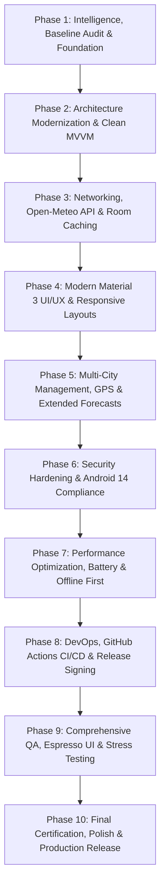

# 05 — Master 10-Phase Transformation Roadmap

## Executive Overview
This roadmap outlines the complete transformation of the **Fomo** Android weather application from an educational static prototype into an elite, production-ready, reactive, modular, and performant weather intelligence platform.

---

## Phase Breakdown Matrix

---

### Phase 1: Project Intelligence, Baseline Audit, Skill System & Foundational Execution (ACTIVE)
- **Goal**: Establish project intelligence, audit codebase, build baseline metrics, setup Antigravity engineering skills, and implement critical foundational fixes (resolve all 10 Android Lint errors, eliminate duplicate IDs, replace reflection, wire version catalog, add unit tests).
- **Subsystems Affected**: `app/build.gradle.kts`, `activity_main.xml`, `HourlyAdapters.java`, `strings.xml`, `libs.versions.toml`.
- **Engineering Specialties**: Principal Architect, Senior Mobile Engineer, QA Engineer, DevOps Engineer.
- **Deliverables**:
  - Full `docs/upgrade/` control center documentation.
  - Permanent `.agents/skills/` system (10 specialized skills).
  - Clean build without Android Lint errors (`lintDebug` exit code 0).
  - Passing unit test suite (`testDebugUnitTest`).
- **Acceptance Criteria**: Zero Lint errors, zero duplicate IDs, unit test baseline passing, debug APK builds deterministically.

---

### Phase 2: Architecture and Codebase Modernization
- **Goal**: Refactor project architecture into Google-standard Clean Architecture with MVVM and Unidirectional Data Flow (UDF).
- **Subsystems Affected**: Package reorganization (`com.example.fomo.ui`, `.domain`, `.data`), ViewModel introduction, ViewBinding migration.
- **Engineering Specialties**: Principal Software Architect, Senior Mobile Engineer.
- **Deliverables**:
  - Package renaming from `Activitis` to idiomatic lowercase Android packages.
  - `WeatherViewModel` with `StateFlow<WeatherUiState>`.
  - Elimination of raw `findViewById` in favor of ViewBinding.
  - Migration from raw `RecyclerView.Adapter` to `ListAdapter<Hourly, HourlyViewHolder>` with `DiffUtil`.
- **Acceptance Criteria**: UI completely decoupled from data creation; ViewBinding active on all layouts; zero memory leaks.

---

### Phase 3: Live Meteorological API Integration & Room Local Persistence
- **Goal**: Connect app to live, free meteorological data (Open-Meteo API) and implement robust offline persistence.
- **Subsystems Affected**: Network client (Retrofit + OkHttp + Kotlinx Serialization / Moshi), Local DB (Room ORM), Repository implementation.
- **Engineering Specialties**: Principal Backend/Data Engineer, Senior Database Architect.
- **Deliverables**:
  - `WeatherRepository` with `RemoteWeatherDataSource` and `LocalWeatherDataSource`.
  - Room database (`FomoDatabase`) with `HourlyForecastEntity` and `CurrentWeatherEntity`.
  - Offline-first cache synchronization policy (Single Source of Truth).
- **Acceptance Criteria**: App displays real-time weather data; app opens and renders cached weather seamlessly in airplane mode.

---

### Phase 4: UI/UX Transformation & Material Design 3 Experience
- **Goal**: Elevate visual design, micro-interactions, responsive typography, and layout flexibility.
- **Subsystems Affected**: `res/layout/`, `res/values/themes.xml`, `res/drawable/`, animations.
- **Engineering Specialties**: Senior UI/UX Design Director, Principal Frontend Engineer.
- **Deliverables**:
  - Material You dynamic theming and polished dark/light mode palette.
  - Fluid card entrance animations and weather condition transitions.
  - Adaptive layouts supporting tablets and foldables.
  - WCAG AAA compliance for text contrast and minimum 48dp touch targets.
- **Acceptance Criteria**: TalkBack accessibility audit passes with 100% compliance; smooth 60/120fps scrolling in horizontal carousel.

---

### Phase 5: Advanced Functional Capabilities, AI Integration, Intelligent Automation & Multi-City Management (COMPLETED)
- **Goal**: Implement complete multi-location management, Open-Meteo Geocoding REST API integration, edge atmospheric intelligence, production AI structured briefings with guardrails, intelligent automation alerting with cooldowns, and IoT weather station telemetry contracts.
- **Subsystems Affected**: `LocationRepository`, `RoomLocationRepository`, `GeocodingApiService`, `FomoDatabase` (v2 with `saved_cities` & `automation_logs`), `AtmosphericIntelligenceService`, `WeatherAiAdvisor`, `WeatherAutomationEngine`, `IotWeatherStationService`, `FeatureFlagService`, `CitySearchBottomSheetDialog`, `MainActivity`.
- **Engineering Specialties**: Principal Product Architect, Senior AI/ML Engineer, Automation Architect, Mobile Engineer, QA Engineer.
- **Deliverables**:
  - Open-Meteo Geocoding API integration with 350ms debounced search and favorites management.
  - Material 3 `CitySearchBottomSheetDialog` and interactive location header.
  - Room Database upgraded to version 2 with deterministic migration `MIGRATION_1_2`.
  - Edge intelligence service computing NOAA Steadman Heat Index, Wind Chill, clothing advice, and 4 activity suitability scores.
  - Structured AI weather briefing engine (`AiWeatherAdvisory`) with dual guardrails (hallucination disparity & prompt injection defense) and deterministic fallback.
  - Event-driven automation engine (`WeatherAutomationEngine`) with 60-min cooldown deduplication and Room audit logging.
  - IoT personal weather station telemetry contract (`IotStationTelemetryDto`) with physical sensor boundary validation and simulator.
  - Runtime feature flags (`FeatureFlagService`).
  - 74 automated unit tests (**100% pass rate**).
  - Clean static quality with 0 Android Lint fatal errors.
  - Clean debug binary assembly (`app-debug.apk`, 7.93 MB).
- **Acceptance Criteria**: Fully verified; all 74 unit tests pass, Lint clean, APK assembled deterministically.

---

### Phase 6: Security Hardening & Android 14/15 Compliance
- **Goal**: Eliminate all potential mobile vulnerabilities, enforce encrypted storage, and configure secure communications.
- **Subsystems Affected**: `AndroidManifest.xml`, network security configuration, encrypted preferences, ProGuard rules.
- **Engineering Specialties**: Senior Security Architect, Compliance Engineer.
- **Deliverables**:
  - Network Security Config enforcing HTTPS and certificate pinning.
  - Encrypted SharedPreferences for user settings.
  - R8 full mode shrinking configuration in `proguard-rules.pro`.
  - Android 14+ runtime permission handling.
- **Acceptance Criteria**: Mobile security vulnerability scan clean; zero exported components without permission gates.

---

### Phase 7: Performance Optimization, Memory Profiling & Battery Efficiency
- **Goal**: Minimize app cold startup time, eliminate all frame drops, optimize image decoding, and preserve battery life.
- **Subsystems Affected**: Layout inflation, Glide caching configuration, background WorkManager sync policies.
- **Engineering Specialties**: Senior Performance Engineer.
- **Deliverables**:
  - App startup optimization (< 500ms cold start).
  - Glide image loading tuned with exact pixel dimensions and memory cache limits.
  - Background weather sync batched using WorkManager with battery-not-low constraints.
- **Acceptance Criteria**: Zero dropped frames during RecyclerView flings; zero memory leaks reported by LeakCanary.

---

### Phase 8: DevOps Automation, CI/CD & Build Pipeline
- **Goal**: Fully automate testing, linting, code coverage reporting, and release artifact generation.
- **Subsystems Affected**: `.github/workflows/`, Gradle build configuration, signing configuration.
- **Engineering Specialties**: Senior DevOps / SRE Engineer.
- **Deliverables**:
  - GitHub Actions CI workflow executing `lintDebug`, `testDebugUnitTest`, and `assembleDebug`.
  - Automated release pipeline producing signed release APK and Android App Bundle (AAB).
  - Gradle build cache and configuration cache optimizations.
- **Acceptance Criteria**: Clean pull request check pipeline completing in under 3 minutes.

---

### Phase 9: Comprehensive QA, Test Automation & Adversarial Testing
- **Goal**: Build an exhaustive test suite covering unit, integration, UI, and edge-case scenarios.
- **Subsystems Affected**: `app/src/test/`, `app/src/androidTest/`.
- **Engineering Specialties**: Principal QA & Test Automation Engineer.
- **Deliverables**:
  - Unit test suite achieving > 85% line coverage across domain and data layers.
  - Robolectric tests for ViewModel and repository integration.
  - Espresso UI tests for carousel scrolling, navigation, and error handling.
  - Adversarial tests: API 500 errors, airplane mode toggling, corrupted JSON payloads.
- **Acceptance Criteria**: 100% deterministic test execution with zero flakiness.

---

### Phase 10: Full-System Certification, Final Polish & Production Readiness
- **Goal**: Full-system audit, regression re-run, documentation completion, and official production certification.
- **Subsystems Affected**: Whole project.
- **Engineering Specialties**: Full Elite Engineering Organization.
- **Deliverables**:
  - Complete verification across all quality gates.
  - Production release candidate APK/AAB.
  - Final developer and operational documentation.
  - Official Production Readiness Certificate.
- **Acceptance Criteria**: Zero P0/P1/P2 defects; all quality gates green; signed release bundle generated.
