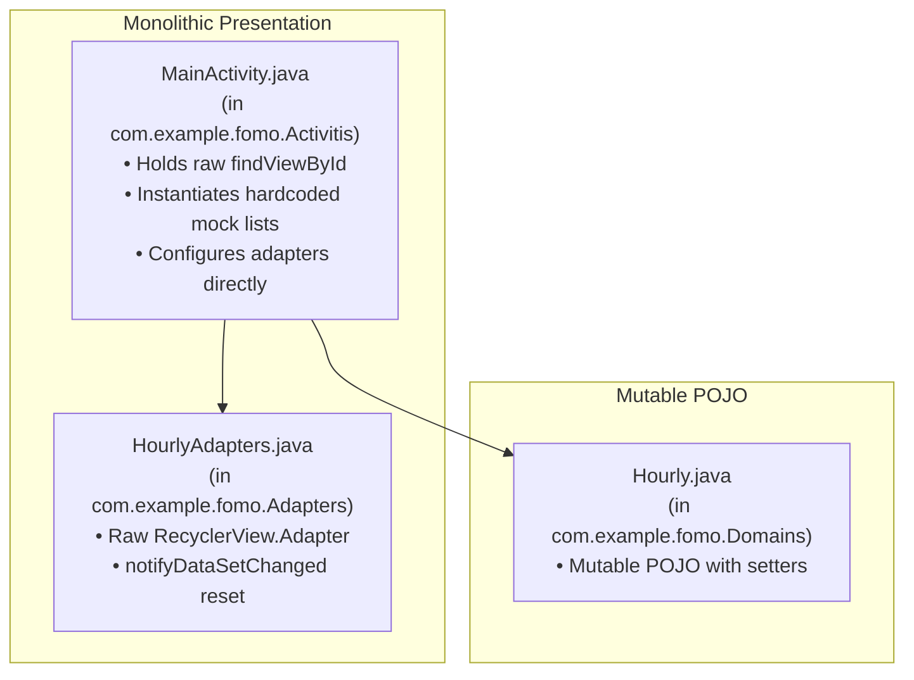

# 10 — Phase 2 Architecture & Codebase Modernization Plan

## 1. Executive Summary & Objectives
Phase 2 modernizes the core architecture of **Fomo** from a monolithic prototype into a decoupled, maintainable, testable, and reactive Android application following Google's official Android Architecture Guidelines and Clean Architecture principles.

### Key Transformation Objectives
1. **Eliminate Monolithic Activity Responsibility**: Decouple UI rendering from data creation, business state, and mock initialization.
2. **Standardize Package Hierarchy**: Replace legacy PascalCase and misspelled directories (`Activitis`, `Adapters`, `Domains`) with strictly lowercase, domain-driven packages (`com.example.fomo.ui.*`, `domain.*`, `data.*`).
3. **Compile-Time View Safety with ViewBinding**: Replace error-prone, runtime `findViewById` calls with Android Jetpack ViewBinding.
4. **Reactive Unidirectional Data Flow (UDF) via MVVM**: Implement `WeatherViewModel` exposing an immutable, typed `WeatherUiState` via `LiveData`.
5. **Modernize Adapter Architecture with DiffUtil**: Upgrade `HourlyAdapter` from a raw `RecyclerView.Adapter` to `ListAdapter<Hourly, HourlyAdapter.ViewHolder>` with asynchronous diffing.
6. **Immutable Domain Layer**: Enforce immutable domain models (`Hourly`, `CurrentWeather`, `WeatherForecast`) with `@NonNull` contracts.
7. **Decoupled Data Layer**: Establish `WeatherRepository` with `InMemoryWeatherRepository` as a clean bridge for Phase 3's Open-Meteo REST API and Room cache integration.

---

## 2. Before vs. After Architecture

### Before Phase 2 (Monolithic Prototype)


### After Phase 2 (Clean MVVM Architecture)
```mermaid
flowchart TD
    subgraph Presentation ["Presentation Layer (com.example.fomo.ui)"]
        V["MainActivity.java\n(in .ui.main)\n• ActivityMainBinding\n• Zero mock data\n• Observes UI state"]
        VM["WeatherViewModel.java\n(in .ui.viewmodel)\n• Exposes LiveData<WeatherUiState>\n• Survives configuration changes"]
        ST["WeatherUiState.java\n(Typed Discriminated Union:\nLoading, Success, Error)"]
        AD["HourlyAdapter.java\n(in .ui.adapter)\n• ListAdapter with DiffUtil\n• ViewholderHourlyBinding"]
        WIM["WeatherIconMapper.java\n(Deterministic compiled resolver)"]
    end

    subgraph Domain ["Domain Layer (com.example.fomo.domain)"]
        WF["WeatherForecast (Composite Entity)"]
        CW["CurrentWeather (Immutable Entity)"]
        H["Hourly (Immutable Entity)"]
        REPO_INT["WeatherRepository (Interface)"]
    end

    subgraph Data ["Data Layer (com.example.fomo.data)"]
        REPO_IMPL["InMemoryWeatherRepository\n(Prepares for Phase 3 API/Room)"]
    end

    V -->|Observes| VM
    V -->|Uses| AD
    V -->|Uses| WIM
    VM -->|Emits| ST
    VM -->|Queries| REPO_INT
    REPO_INT <|.. REPO_IMPL
    REPO_IMPL -->|Constructs| WF
    WF --> CW
    WF --> H
```

---

## 3. Evaluated Architectural Alternatives

### Alternative A: Full Jetpack Compose Rewrite
- **Evaluation**: Rewriting the entire UI in Jetpack Compose would replace XML layouts completely.
- **Verdict**: **Rejected for Phase 2**. Prematurely rewriting working layouts violates Non-Negotiable Invariant 1 ("Preserve Working Functionality"). The XML layouts were successfully stabilized in Phase 1; migrating to Compose belongs to Phase 4 (UI/UX transformation) after data and repository layers are rock-solid.

### Alternative B: Direct LiveData in Repository
- **Evaluation**: Having the repository expose `LiveData` directly to the ViewModel.
- **Verdict**: **Rejected**. Repositories should remain independent of Android presentation lifecycle components. The repository exposes callbacks/synchronous methods; the ViewModel maps these into lifecycle-aware `LiveData`/`StateFlow`.

### Alternative C: Selected Pattern — Google Android Clean MVVM with ViewBinding & ListAdapter
- **Verdict**: **Approved**. Industry-standard, backwards-compatible to API 24, zero reflection, 100% testable on pure JVM without Robolectric.
