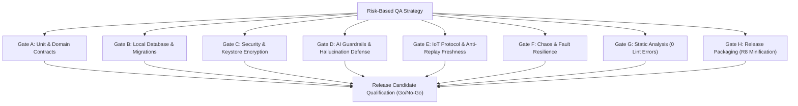

# 107 — Phase 9 Full-System QA Strategy & Risk-Based Methodology

## Executive Overview
Phase 9 executes principal-level quality assurance, adversarial verification, automated defect remediation, and release candidate certification across the **Fomo** Android weather intelligence application (`com.example.fomo`).

---

## 1. Quality Engineering Architecture

---

## 2. Test Prioritization Levels

- **P0 (Release Blocker)**: Data loss, hardware Keystore failure, unhandled crash on startup, missing Android Lint quality gates, broken release packaging.
- **P1 (Critical Priority)**: Upstream circuit breaker failure, security sanitization bypass, gross AI temperature hallucination (> 6°C), IoT replay attack vulnerability.
- **P2 (High Priority)**: Internationalization locale defect (`Locale.ROOT`), percentage/wind speed unbounded values, cache eviction anomalies.
- **P3 (Normal Priority)**: Cosmetic layout discrepancies, minor log formatting polish.

---

## 3. Test Environments
1. **Host JVM Test Harness**: Deterministic, high-velocity execution of isolated unit, domain calculation, and security tests.
2. **Android Lint Engine**: AST-based static inspection of all manifest files, resource layouts, security attributes, and API version compatibility.
3. **R8 / ProGuard Shrinker**: Bytecode analysis and dead-code/resource elimination verifying release artifact determinism.

