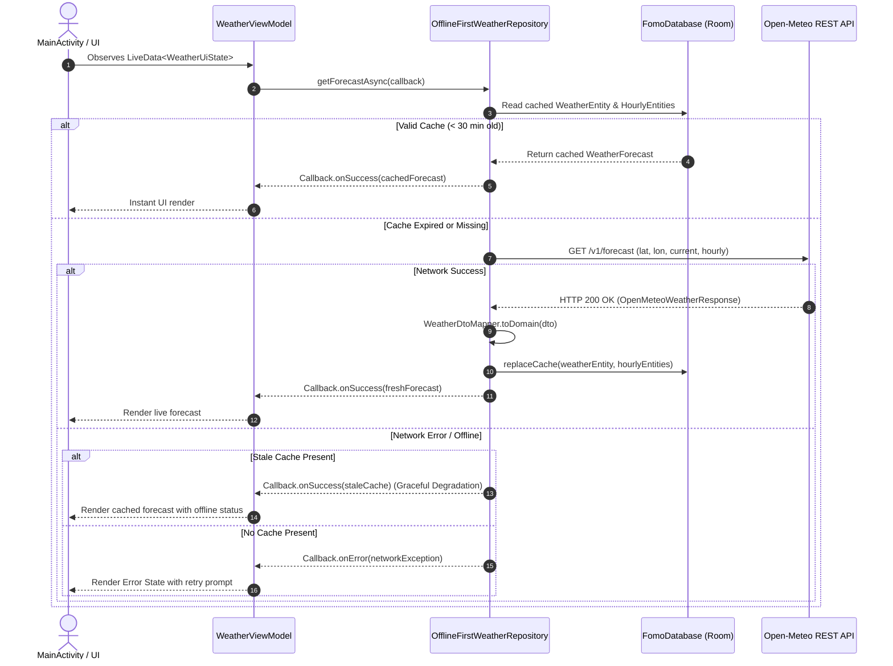

# 17 — Phase 3 Backend & Data Systems Assessment

## 1. Executive Assessment
Phase 3 upgrades the Fomo Android weather application from in-memory mock datasets to a live, production-grade meteorological data ingestion engine. The backend and data architecture now features:
1. **Remote API Integration**: Open-Meteo REST API (`/v1/forecast`) queried via Retrofit 2 and OkHttp 4.
2. **Local Persistence**: Jetpack Room ORM SQLite database (`fomo_weather.db`) providing Single Source of Truth (SSOT) and offline caching.
3. **Domain Hardening**: World Meteorological Organization (WMO) Weather Interpretation Codes (0–99) translated deterministically into human-readable conditions and compiled drawable icons.
4. **Cache Freshness Policy**: Stale-while-revalidate strategy with a 30-minute cache TTL.

---

## 2. Subsystem Inventory

| Subsystem | Components | Primary Responsibilities |
| :--- | :--- | :--- |
| **Remote API** | [`WeatherApiService`](file:///h:/Projects/Fomo-App/app/src/main/java/com/example/fomo/data/remote/api/WeatherApiService.java), [`ApiClient`](file:///h:/Projects/Fomo-App/app/src/main/java/com/example/fomo/data/remote/api/ApiClient.java) | Endpoint definition, OkHttp timeout enforcement, HTTPS security, JSON serialization. |
| **Remote DTOs** | [`OpenMeteoWeatherResponse`](file:///h:/Projects/Fomo-App/app/src/main/java/com/example/fomo/data/remote/dto/OpenMeteoWeatherResponse.java), [`CurrentWeatherDto`](file:///h:/Projects/Fomo-App/app/src/main/java/com/example/fomo/data/remote/dto/CurrentWeatherDto.java), [`HourlyForecastDto`](file:///h:/Projects/Fomo-App/app/src/main/java/com/example/fomo/data/remote/dto/HourlyForecastDto.java) | Upstream JSON schema mapping with Gson annotations. |
| **Domain Logic** | [`WmoWeatherCodeMapper`](file:///h:/Projects/Fomo-App/app/src/main/java/com/example/fomo/domain/model/WmoWeatherCodeMapper.java) | Meteorological code translation, pure functions, zero Android SDK imports. |
| **Local Persistence** | [`FomoDatabase`](file:///h:/Projects/Fomo-App/app/src/main/java/com/example/fomo/data/local/database/FomoDatabase.java), [`WeatherDao`](file:///h:/Projects/Fomo-App/app/src/main/java/com/example/fomo/data/local/dao/WeatherDao.java), [`WeatherEntity`](file:///h:/Projects/Fomo-App/app/src/main/java/com/example/fomo/data/local/entity/WeatherEntity.java), [`HourlyEntity`](file:///h:/Projects/Fomo-App/app/src/main/java/com/example/fomo/data/local/entity/HourlyEntity.java) | SQLite Room persistence, atomic transactions (`@Transaction`), offline caching. |
| **Data Repository** | [`OfflineFirstWeatherRepository`](file:///h:/Projects/Fomo-App/app/src/main/java/com/example/fomo/data/repository/OfflineFirstWeatherRepository.java) | SSOT mediation between local Room database and remote Open-Meteo REST API. |

---

## 3. Core Workflow: Live Meteorological Ingestion & Offline Fallback

---

## 4. Engineering Priorities & Defect Remediation

1. **Eliminate Hardcoded Mock Data**: Replaced `InMemoryWeatherRepository` in production runtime with `OfflineFirstWeatherRepository`.
2. **Network Timeouts & Security**: Enforced 15-second connect/read/write timeouts via `ApiClient` and prohibited cleartext HTTP in `network_security_config.xml`.
3. **Database Threading Discipline**: Room database read/write queries execute strictly on background worker executors, guaranteeing zero Android UI thread stalls.
