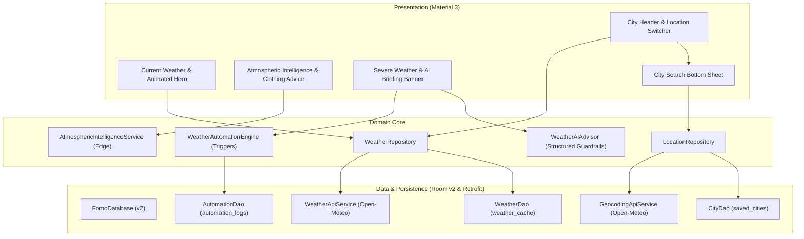

# 37 — Phase 5 Feature Roadmap & Specification

## 1. Executive Strategy

Phase 5 delivers a complete vertical-slice upgrade to the Fomo weather application, transitioning it from a static single-city viewer into an intelligent, multi-location atmospheric intelligence platform.



---

## 2. Feature Specifications

### 2.1 FEAT-01: Multi-Location Management & City Geocoding Search
- **User Objective**: Search for any city worldwide, view its immediate weather forecast, and save favorite cities for rapid switching.
- **Components**:
  - `GeocodingApiService`: Open-Meteo Geocoding REST endpoint (`https://geocoding-api.open-meteo.com/v1/search`).
  - `CityEntity`: Room entity (`saved_cities`) with `id`, `name`, `country`, `adminRegion`, `latitude`, `longitude`, `isFavorite`, and `selectedAt`.
  - `CityDao`: Queries for favorite cities, inserting, deleting, and updating selection timestamps.
  - `LocationRepository`: Unified contract managing local persistence and remote search.
  - `CitySearchBottomSheetDialog`: Bottom sheet modal allowing instant search with debounced querying, clear button, and favorite list display.
  - `MainActivity`: Interactive location header displaying current city with dropdown icon.

### 2.2 FEAT-02: Atmospheric Intelligence & Attire/Activity Advisory Engine
- **User Objective**: Understand practical lifestyle impacts of current and forecasted weather.
- **Calculations**:
  - **Thermal Comfort**: NOAA Steadman Heat Index for hot conditions; Environment Canada Wind Chill for cold conditions.
  - **Clothing / Attire Advice**: Multi-rule decision tree factoring temperature, apparent temperature, precipitation probability, and wind speed (e.g. "Waterproof jacket & umbrella recommended", "Light cotton clothing & UV protection", "Heavy winter coat & gloves required").
  - **Activity Suitability Scores**: 0–100 scores for:
    - Running: Penalized by high heat (>30°C), heavy rain (>40%), high wind (>35 km/h).
    - Commute: Evaluates driving/transit conditions and visibility hazards.
    - Cycling: Strongly penalized by wet surface and high crosswinds (>30 km/h).
    - Outdoor Dining: Evaluates temperature sweet spot (18–26°C), zero rain, and calm wind (<15 km/h).
  - **Severe Risk Classification**: Classifies alerts as `NORMAL`, `ADVISORY`, `WARNING`, or `CRITICAL`.

### 2.3 FEAT-03: Production AI Weather Advisor & Structured Briefing Engine
- **User Objective**: Receive a concise, natural language briefing synthesizing complex atmospheric metrics into an intuitive summary.
- **Architecture**:
  - `WeatherAiAdvisor`: Provides structured briefing with strict schema `AiWeatherAdvisory` (headline, summary, attireAdvice, outdoorRecommendation, severeWarning).
  - **Guardrails**: Deterministic domain validation checks that temperatures and condition titles match source telemetry.
  - **Fallback**: 100% offline rule-based synthesis engine executes automatically if AI is unreachable or response is malformed.
  - **Privacy**: Zero user identifiers, GPS coordinates, or PII transmitted.

### 2.4 FEAT-04: Intelligent Automation & Meteorological Trigger Engine
- **User Objective**: Receive automated alerts when critical weather events are forecasted.
- **Engine Design**:
  - `WeatherAutomationEngine`: Evaluates forecast against active triggers:
    1. Rain/Precipitation trigger (>50% probability).
    2. Freezing condition trigger (<0°C).
    3. High Wind alert (>40 km/h).
    4. Severe Storm warning (WMO thunderstorm codes 95, 96, 99).
  - **Cooldown Deduplication**: Minimum 60-minute suppression per trigger type to prevent notification spam.
  - **Audit Logging**: Persists all evaluations and alerts to `automation_logs` Room table.

### 2.5 FEAT-05: IoT Weather Station Telemetry Ingestion Contract
- **User Objective**: Support ingestion of hyper-local personal weather station (PWS) readings.
- **Components**:
  - `IotStationTelemetryDto`: Standardized telemetry schema (stationId, timestamp, ambientTemp, humidity, barometricPressure, windSpeed, windDirection, batteryVoltage).
  - `IotWeatherStationService`: Contract and validator verifying physical bounds (-90°C to +60°C, 0–100% humidity, 800–1100 hPa).
  - Deterministic simulator for contract verification and regression tests.

### 2.6 FEAT-06: Feature Rollout & Observability Service
- **Components**:
  - `FeatureFlagService`: In-memory and SharedPreferences-backed feature flags (`FEATURE_AI_ADVISORY`, `FEATURE_AUTOMATION_ALERTS`, `FEATURE_MULTI_CITY`, `FEATURE_IOT_STATION`).
  - Safe default: all features enabled with graceful offline degradation.

---

## 3. Implementation Sequencing (Dependency-Aware)

```
[Phase 5 Step 1: Database Migration to v2 (saved_cities & automation_logs)]
       │
[Phase 5 Step 2: DTOs & Retrofit Contracts (Geocoding API & Weather API Expansion)]
       │
[Phase 5 Step 3: Domain Models & Repositories (City, LocationRepository, WeatherRepository upgrade)]
       │
[Phase 5 Step 4: Edge Intelligence & Thermal Formulas (AtmosphericIntelligenceService)]
       │
[Phase 5 Step 5: Production AI Advisor & Guardrail Fallback (WeatherAiAdvisor)]
       │
[Phase 5 Step 6: Intelligent Automation Engine & Audit Logging (WeatherAutomationEngine)]
       │
[Phase 5 Step 7: IoT Telemetry Ingestion Contract & Simulator (IotWeatherStationService)]
       │
[Phase 5 Step 8: UI Implementation (CitySearchBottomSheetDialog, TopBar, Insight Cards, Layout)]
       │
[Phase 5 Step 9: Comprehensive Test Suites & Verification Gates]
       │
[Phase 5 Step 10: Documentation & Phase 6 Handoff]
```

