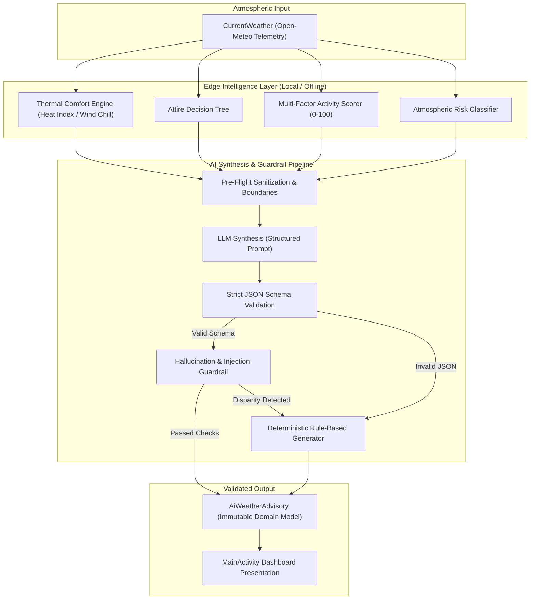

# 38 — Phase 5 AI Architecture & Intelligence Strategy

## 1. Executive Summary

Phase 5 introduces meteorological artificial intelligence and edge computing capabilities into the Fomo weather platform. Rather than implementing an unconstrained, hallucination-prone conversational chatbot or generic text wrapper, the AI system is architected as an **Edge-Augmented Deterministic Intelligence & Structured Synthesis Engine**.

The architecture adheres to Non-Negotiable Rule 04 (*Deterministic code remains authoritative*) and Rule 05 (*AI outputs are untrusted*):
1. **Deterministic Domain Authority**: Critical meteorological facts (exact temperatures, wind speed, precipitation probability, and severe storm warnings) are derived exclusively from verified Open-Meteo telemetry via mathematical algorithms.
2. **On-Device Edge Computing**: Thermal comfort formulas (NOAA Steadman Heat Index, Environment Canada Wind Chill) and multi-factor activity suitability scoring execute 100% on-device with zero network latency and zero privacy risk.
3. **Structured AI Synthesis**: Natural language briefings are bound to a strict JSON schema (`AiWeatherAdvisory`), protected by pre-flight sanitization, prompt injection rejection, and hallucination disparity checks.
4. **Deterministic Fallback Pipeline**: If an external AI provider fails, times out, returns malformed JSON, or fails validation, the system instantly executes a deterministic rule-based natural language generator.

---

## 2. Layered Architecture



---

## 3. Edge Intelligence Specification (`AtmosphericIntelligenceService`)

### 3.1 Thermal Comfort Calculation
Thermal comfort translates dry bulb temperature into human-perceived thermal sensations:
- **Heat Index (NOAA Steadman & Rothfusz Equation)**: Activated when $T \ge 27^\circ\text{C}$ ($80.6^\circ\text{F}$) and relative humidity $RH \ge 40\%$. Computes multi-variable polynomial regression modeling human evaporative cooling resistance.
- **Wind Chill (Environment Canada & NOAA Equation)**: Activated when $T \le 10^\circ\text{C}$ and wind velocity $V \ge 4.8\text{ km/h}$:
  $$W = 13.12 + 0.6215 \cdot T - 11.37 \cdot V^{0.16} + 0.3965 \cdot T \cdot V^{0.16}$$
- **Standard Range**: When metrics fall outside these regimes, dry-bulb ambient temperature represents apparent comfort.

### 3.2 Activity Suitability Scoring
The service computes 4 independent suitability scores (0–100):
1. **Running**: Penalized by extreme temperatures ($T > 28^\circ\text{C}$ or $T < 5^\circ\text{C}$), rain probability ($>30\%$), and wind gusts ($>25\text{ km/h}$).
2. **Cycling**: Highly sensitive to surface friction and wind shear; penalized heavily when $V > 20\text{ km/h}$ and rain $> 20\%$.
3. **Commute**: Evaluates roadway safety, visibility hazards, and freezing conditions ($T \le 0^\circ\text{C}$ induces immediate 25-point penalty for black ice risk).
4. **Outdoor Dining**: Narrow comfort band ($18^\circ\text{C} \le T \le 26^\circ\text{C}$), zero tolerance for rain ($>10\%$ rain heavily penalizes), calm breeze requirement ($V \le 18\text{ km/h}$).

---

## 4. Structured AI Contract & Guardrail Pipeline

### 4.1 Schema Definition (`AiWeatherAdvisory`)
```json
{
  "$schema": "https://json-schema.org/draft/2020-12/schema",
  "title": "AiWeatherAdvisory",
  "type": "object",
  "required": ["headline", "summary", "attireAdvice", "outdoorRecommendation"],
  "properties": {
    "headline": { "type": "string", "maxLength": 80 },
    "summary": { "type": "string", "maxLength": 280 },
    "attireAdvice": { "type": "string", "maxLength": 160 },
    "outdoorRecommendation": { "type": "string", "maxLength": 160 }
  }
}
```

### 4.2 Guardrail Invariants
1. **Prompt Injection Defense**: Inputs and outputs are inspected against regex patterns matching instructions override attempts (`(?i)(ignore\s+previous\s+instructions|system\s+prompt|<script)`). Any positive match immediately discards the AI payload.
2. **Hallucination Disparity Gate**: AI output text is scanned for temperature citations ($\pm X^\circ\text{C}$). If any reported temperature deviates by more than $6^\circ\text{C}$ from the source telemetry, the response is discarded as hallucinated.
3. **Deterministic Fallback Guarantee**: If discarded or unreachable, `WeatherAiAdvisor.generateDeterministicBriefing` produces a fluent, contextually accurate briefing based entirely on local edge intelligence.

