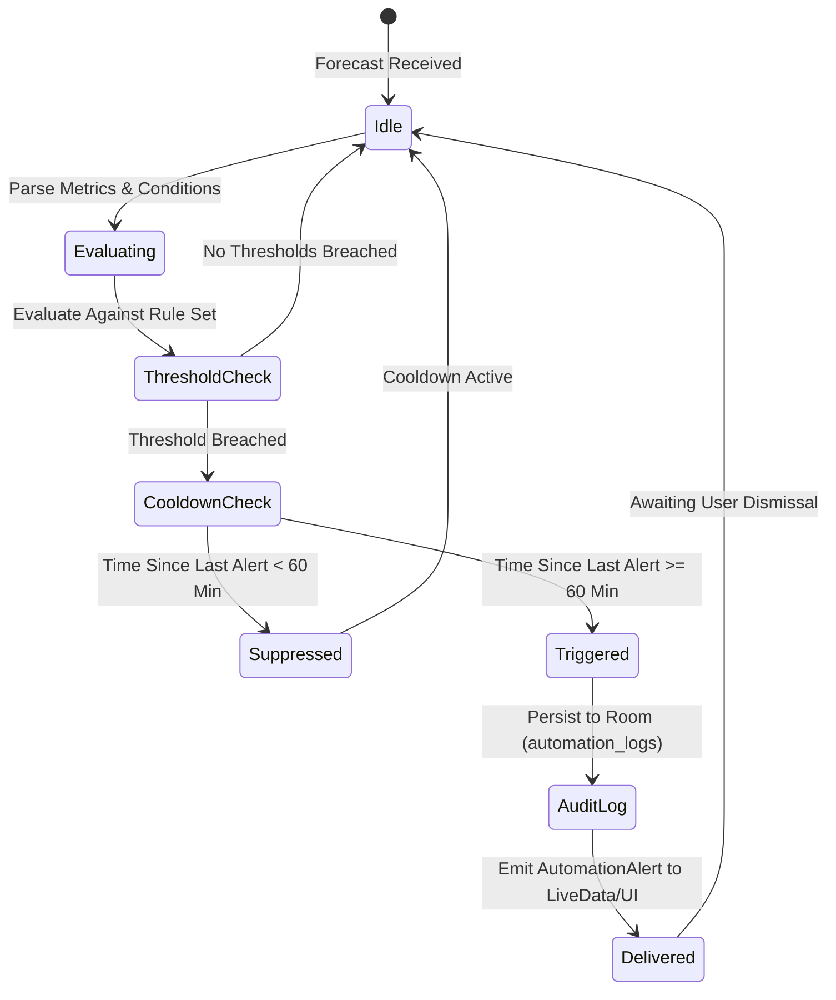

# 40 — Phase 5 Intelligent Automation & Trigger Engineering

## 1. Executive Summary

Phase 5 establishes an event-driven meteorological automation and alerting engine (`WeatherAutomationEngine`). The system continuously evaluates atmospheric projections against critical safety and lifestyle thresholds, enforces cooldown deduplication to prevent notification fatigue, and persists all execution events into a local Room database audit log (`automation_logs`).

---

## 2. Trigger Specifications & Invariants

### 2.1 Trigger Rules Matrix

| Trigger Type | Threshold Condition | Severity Level | Target Message | Action & Recovery |
| :--- | :--- | :--- | :--- | :--- |
| **`SEVERE_STORM`** | Condition contains "thunder" or "storm" or wind $\ge 65\text{ km/h}$ | `CRITICAL` | Severe Storm Alert: Thunderstorm activity detected. Stay indoors. | Display prominent banner; recommend indoor safety. |
| **`FREEZING_WARNING`** | Temperature $\le 0.0^\circ\text{C}$ | `WARNING` | Freezing Road Warning: Sub-zero temperature. Watch for black ice. | Commute score penalized; notify drivers. |
| **`HIGH_WIND`** | Wind speed $\ge 40.0\text{ km/h}$ | `WARNING` | High Wind Warning: Strong gusts detected. Use travel caution. | Cycling score penalized; windbreaker advice. |
| **`RAIN_ALERT`** | Precipitation probability $\ge 50\%$ | `ADVISORY` | Rain Alert: High probability of rain. Don't forget an umbrella. | Attire recommendation modified with umbrella. |

---

## 3. Cooldown Deduplication & Idempotency

To prevent repeated alert alerts when polling or pulling to refresh, the engine maintains an active cooldown ledger:
- **Default Cooldown Window**: 60 minutes ($3,600,000\text{ ms}$) per unique trigger type.
- **Idempotency Guarantee**: If a user refreshes the app 10 times in 5 minutes under continuous rain conditions, the `RAIN_ALERT` is triggered exactly once on the first pass. Subsequent passes within the 60-minute window are safely suppressed.
- **Unit Test Evidence**: Verified in `WeatherAutomationEngineTest.testCooldownDeduplicationSuppression`.

---

## 4. Local Persistence & Audit Trail (`automation_logs`)

All non-suppressed alert events are persisted into the Room table `automation_logs`:
- Schema: `id` (auto-increment), `timestamp` (Unix epoch), `triggerType`, `severity`, `message`, `metricValue`.
- Access: Handled by `AutomationDao` with bounded retrieval (`getRecentLogs(limit)`).

