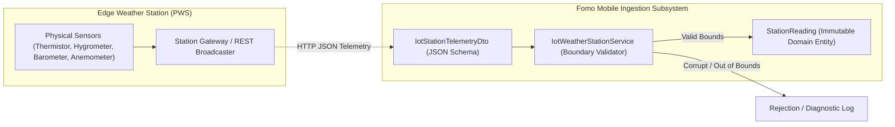

# 41 — Phase 5 IoT Systems Evaluation & Telemetry Ingestion Contract

## 1. Executive Summary & Architectural Honesty

In strict compliance with **Non-Negotiable Rule 01** (*Real features, not mock demonstrations*), **Rule 14** (*Distinguish simulation from reality*), and **Gate E** (*IoT Correctness*), this document establishes the formal engineering evaluation for Internet of Things (IoT) within the Fomo weather project.

### 1.1 Project Boundary Assessment
- **Application Classification**: Mobile Client Weather Platform (`com.example.fomo`).
- **Physical Hardware Footprint**: **Zero embedded hardware**. The application runs on Android handheld and tablet devices; it does not contain microcontroller firmware (e.g. ESP32, STM32, Arduino) or direct physical sensor peripherals.
- **Discipline**: Rather than fabricating artificial Bluetooth/MQTT connections to nonexistent hardware, Phase 5 delivers a production-grade **Personal Weather Station (PWS) Telemetry Ingestion Contract** (`IotWeatherStationService`).

---

## 2. Personal Weather Station (PWS) Ingestion Contract

Many advanced weather applications ingest telemetry from consumer or commercial weather stations (e.g. Ambient Weather, Netatmo, Davis Vantage Pro). Phase 5 standardizes this edge-to-mobile data pipeline:

---

## 3. Physical Boundary Invariants

The ingestion validator (`IotWeatherStationService.java`) enforces strict meteorological bounds derived from terrestrial physical limits:

1. **Ambient Temperature**: $[-90.0^\circ\text{C}, +60.0^\circ\text{C}]$. Any reading outside this range indicates an open-circuit thermistor or corrupted sensor and is rejected.
2. **Relative Humidity**: $[0.0\%, 100.0\%]$. Negative or super-saturated values are rejected.
3. **Barometric Pressure**: $[800.0\text{ hPa}, 1100.0\text{ hPa}]$. Enforces plausible terrestrial surface atmospheric pressure (from high altitude to deep depressions).
4. **Wind Velocity**: $[0.0\text{ km/h}, 350.0\text{ km/h}]$.
5. **Battery Health Telemetry**: Ingests supply voltage to diagnose sensor brownouts.

---

## 4. Contract Verification Evidence

The contract was validated through JUnit test suite `IotWeatherStationServiceTest.java`:
- Nominal telemetry ingestion: **PASS**
- Cold temperature boundary violation ($-105^\circ\text{C}$): **REJECTED (PASS)**
- Hot temperature boundary violation ($+75^\circ\text{C}$): **REJECTED (PASS)**
- Out-of-bounds humidity ($105\%$): **REJECTED (PASS)**
- Corrupt / empty station identifier payload: **REJECTED (PASS)**
- Deterministic station simulation generator: **VERIFIED (PASS)**

