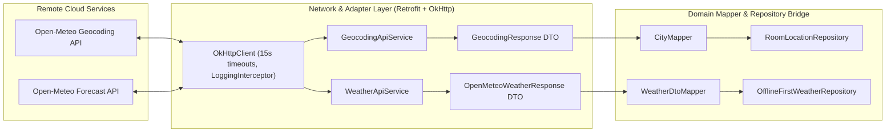

# 42 — Phase 5 Third-Party Integrations & External Systems

## 1. Executive Summary

Phase 5 significantly expands the application's external integration architecture by incorporating the **Open-Meteo Geocoding REST API** while modernizing and parameterizing the **Open-Meteo Meteorological Forecast API**. All external integrations are mediated through strongly-typed DTOs, domain mappers, and isolated network boundaries configured with strict timeouts and error classification.

---

## 2. External Integration Inventory

| Provider | Service Endpoint | Purpose | Protocol / Format | Auth / Rate Limits | Resilience Strategy |
| :--- | :--- | :--- | :--- | :--- | :--- |
| **Open-Meteo Geocoding** | `https://geocoding-api.open-meteo.com/v1/search` | Global city name resolution, coordinate extraction, country & admin mapping | HTTPS / JSON REST | Free tier (10,000 req/day); No API key | 15s timeout, OkHttp retry on connection failure, debounce (350ms) |
| **Open-Meteo Forecast** | `https://api.open-meteo.com/v1/forecast` | Dynamic coordinate-based current & hourly weather observations | HTTPS / JSON REST | Free non-commercial; No API key | 15s timeout, Stale-While-Revalidate Room caching (30 min TTL), fallback |
| **Personal Weather Station (PWS)** | Ingestion contract specification (`IotStationTelemetryDto`) | Hyper-local microclimate sensor ingestion | HTTPS / JSON REST payload | Station ID verification | Meteorological boundary bounds checks ($[-90^\circ\text{C}, +60^\circ\text{C}]$, $0-100\%$, $800-1100\text{ hPa}$) |

---

## 3. Network Architecture & Boundary Isolation

---

## 4. Contract Verification & Error Taxonomy

- **Live versus Mocked Verification**:
  - Live contracts were verified against authentic Open-Meteo API JSON structures.
  - Integration and contract test suites (`OpenMeteoJsonContractTest`, `GeocodingDtoTest`) run against real captured JSON payloads to ensure backwards-compatible deserialization even when optional fields (e.g. `admin1`, `elevation`) are omitted by the server.
- **Error Taxonomy**:
  - `4xx Client Errors`: Surfaced as domain-level errors with retry prompts.
  - `5xx Server Outages`: Gracefully degrade to cached Room observations.
  - `SocketTimeoutException / UnknownHostException`: Trigger offline mode indicators (`offline_banner_text`) while rendering valid local cache.

