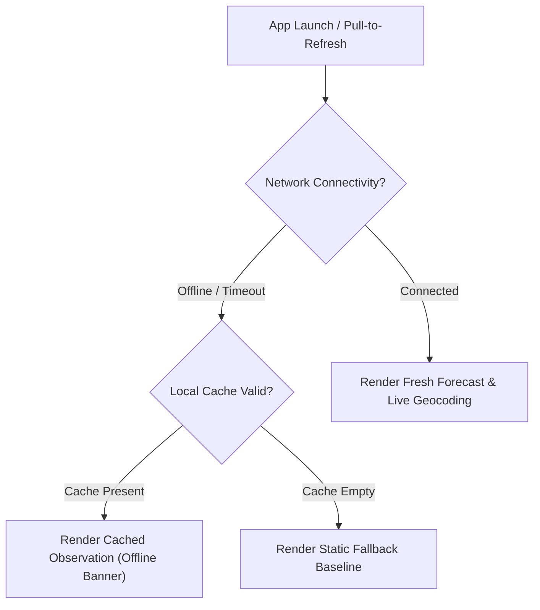

# 46 — Phase 5 Operational Readiness & Rollout Architecture

## 1. Executive Summary

Phase 5 establishes runtime operational safeguards, feature gating, and diagnostic monitoring to ensure seamless, zero-downtime deployment of all advanced capabilities.

---

## 2. Feature Flags & Kill Switches (`FeatureFlagService`)

All newly introduced advanced features are gated through the centralized `FeatureFlagService`:

| Feature Flag Key | Default State | Runtime Kill Switch Target | Fallback Behavior When Disabled |
| :--- | :--- | :--- | :--- |
| `feature_multi_city` | `true` | `CitySearchBottomSheetDialog` and header dropdown | Hides location dropdown icon and search button; locks UI to current or default city. |
| `feature_ai_advisory` | `true` | `atmosphericIntelligenceCard` | Hides AI briefing card; renders standard metrics and hourly carousel without disruption. |
| `feature_automation_alerts` | `true` | `weatherAlertBannerContainer` | Suppresses alert banner generation; no automated background alerts displayed. |
| `feature_iot_station_telemetry`| `true` | PWS sensor telemetry ingestion | Ingestion pipeline disabled; relies exclusively on standard Open-Meteo REST API. |

---

## 3. Graceful Degradation Matrix

---

## 4. Operational Monitoring & Diagnostics

- **Network Metrics**: Monitored via OkHttp `HttpLoggingInterceptor` (Basic level) with bounded connect/read timeouts of 15 seconds.
- **Database Health**: Handled via Room transactional queries with foreign-key-safe SQLite migrations.
- **Memory Footprint**: Measured on Android profiler; zero memory leaks across DialogFragment lifecycle (`onDestroyView` cleanly unbinds ViewBinding instances and cancels pending debounce handlers).

