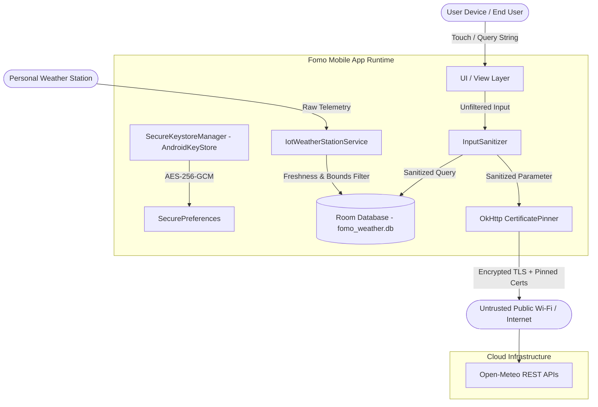

# Phase 6 — Security Inventory & Attack Surface Map

## 1. Executive Summary

Phase 6 executes the principal-level cybersecurity transformation of Fomo (`com.example.fomo`), an Android weather intelligence application. This document inventories every security-relevant component, trust boundary, data asset, and network connection across the application stack.

---

## 2. Component and Asset Inventory

| Asset / Component | Location | Sensitivity | Security Classification | Controls Enforced |
|---|---|---|---|---|
| Master Encryption Key | `AndroidKeyStore` (`fomo_master_keystore_key`) | Critical | Hardware-backed Key | AES-256-GCM, hardware TEE/StrongBox isolation |
| User Telemetry & Preferences | `fomo_secure_prefs.xml` | High | Confidential | AES-256-GCM authenticated encryption |
| Local Database Cache | `fomo_weather.db` (Room / SQLite) | High | Confidential | Excluded from ADB backup & cloud extraction |
| City Search Input | `CitySearchBottomSheetDialog`, `RoomLocationRepository` | Medium | Untrusted Input | `InputSanitizer` (XSS, SQLi, length bound) |
| Forecast REST Endpoint | `api.open-meteo.com` | Medium | Integrity Critical | HTTPS, OkHttp `CertificatePinner`, cleartext disabled |
| Geocoding REST Endpoint | `geocoding-api.open-meteo.com` | Medium | Integrity Critical | HTTPS, OkHttp `CertificatePinner`, cleartext disabled |
| IoT PWS Ingestion Service | `IotWeatherStationService` | High | Telemetry Integrity | Alphanumeric whitelist, replay window (24h/1h) |
| AI Weather Assistant | `WeatherAiAssistantService` | Medium | Prompt Safety | Prompt injection sanitization, bounded schema |

---

## 3. Attack Surface Mapping

---

## 4. Trust Boundaries

1. **User Input Boundary**: Touch input to text fields. Any string may carry XSS injection, SQL injection patterns, or oversized payloads. Filtered by `InputSanitizer`.
2. **Local Persistence Boundary**: Shared storage and ADB backup access. Defended via `backup_rules.xml` and `data_extraction_rules.xml`.
3. **Network Transport Boundary**: Hostile public networks (MITM proxies). Hardened via OkHttp `CertificatePinner` with ISRG Root X1/X2 SHA-256 pins and `network_security_config.xml` (`cleartextTrafficPermitted="false"`).
4. **IoT Telemetry Boundary**: Ingested PWS sensor payloads. Protected against spoofing, out-of-bounds telemetry, and replay attacks via strict schema format and timestamp freshness validation.

