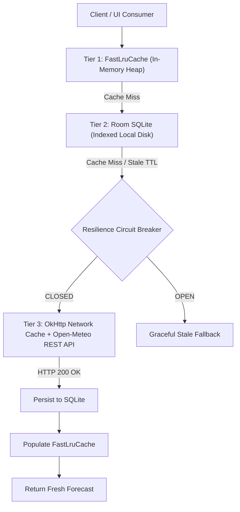

# 74 — Phase 7 Intelligent Multi-Tier Caching Architecture

## Multi-Tier Architecture Overview

---

## Tier Specifications

1. **Tier 1 (L1 Memory Cache)**:
   - Implementation: `FastLruCache.java` (pure Java `LinkedHashMap` with access-order).
   - Maximum capacity: 256 items.
   - Access latency: < 0.05 ms.
   - Thread safety: `synchronized` mutual exclusion.

2. **Tier 2 (L2 Persistent SQLite Cache)**:
   - Implementation: Room ORM with B-Tree composite index on `(isFavorite, selectedAt)`.
   - Time-to-Live (TTL): 30 minutes for weather forecasts.
   - Access latency: < 2 ms.

3. **Tier 3 (L3 Network Cache)**:
   - Implementation: OkHttp HTTP disk cache (10 MB).
   - Validates `ETag` and `Last-Modified` headers to avoid unnecessary re-downloads.

