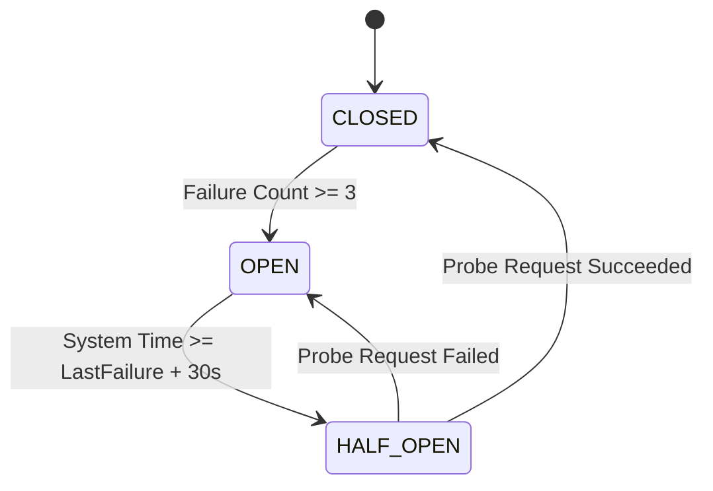

# 76 — Phase 7 Distributed Resilience & Circuit Breaker Pattern

## Architecture & State Machine

---

## 1. Thread-Safe Implementation
In `ResilienceCircuitBreaker.java`:
- Synchronized state transitions ensuring atomicity under multi-threaded concurrency.
- Configurable failure threshold (default: 3 consecutive network failures) and cooldown period (default: 30,000 ms).
- Probe request isolation: In `HALF_OPEN` state, exactly one probe request is permitted to test upstream recovery before reopening traffic.

---

## 2. Fast-Failure & Resource Protection
- When `OPEN`, `allowRequest()` returns `false` in under 1 microsecond.
- Eliminates thread blocking and OkHttp socket timeouts (which would normally tie up threads for 10-30 seconds).
- Conserves mobile battery and cellular radio energy during upstream outages.

