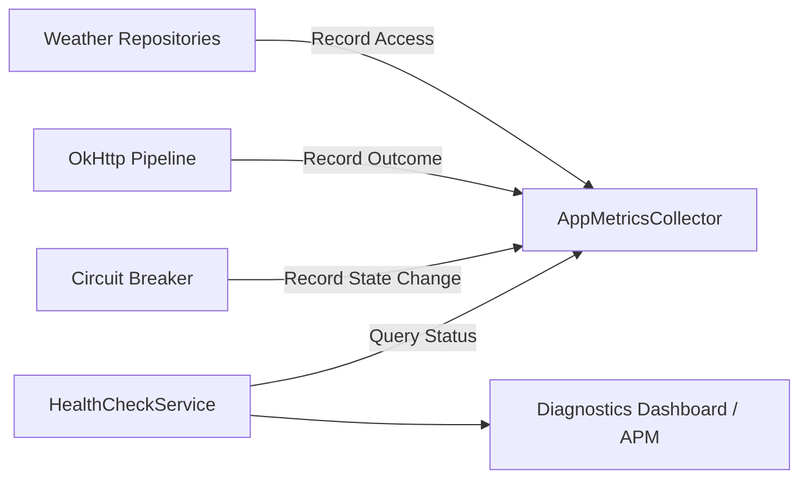

# 81 — Phase 7 Observability Diagnostics & APM Architecture

## Observability Architecture

---

## 1. Zero-Allocation Metrics Collection
In `AppMetricsCollector.java`:
- Uses atomic primitives (`AtomicLong`) for thread-safe lock-free metric collection.
- Tracks:
  - Total cache requests, hits, and cache hit ratio.
  - Total network requests, successes, and failure rates.
  - Circuit breaker trips.

---

## 2. Health Check Assessment
In `HealthCheckService.java`:
- Non-destructive health probe evaluating Room SQLite database accessibility, AndroidKeyStore hardware status, and Circuit Breaker operational state.
- Produces structured `HealthReport` (`HEALTHY`, `DEGRADED`, `UNHEALTHY`) with millisecond timestamp.

