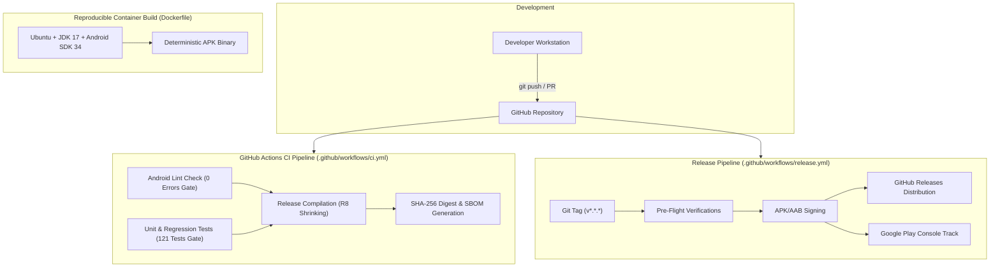

# 87 — Phase 8 Cloud & Deployment Architecture Overview

## Deployment Architecture Diagram

---

## Infrastructure Boundaries
1. **Source Repository**: GitHub repository enforcing branch protection on `main` requiring passing CI status checks.
2. **Build Runners**: Standard `ubuntu-latest` GitHub-hosted runners or local Docker containers (`docker-compose up`).
3. **Distribution Channels**:
   - Internal Testing Track: For automated dogfooding and QA testing.
   - Production Track: Google Play Store with staged rollouts (10% -> 25% -> 50% -> 100%).
   - Direct Distribution: Signed standalone APKs with verifiable SHA-256 checksums published on GitHub Releases.

