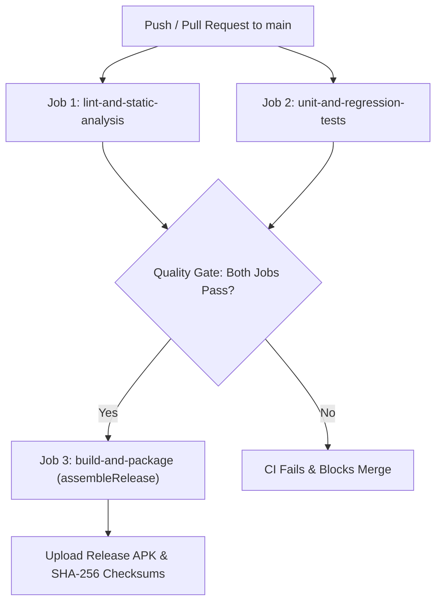

# 90 — Phase 8 Continuous Integration Implementation Report

## Workflow Architecture

The CI pipeline is structured into three decoupled, gate-keeping jobs:

---

## Job Details & Timing Estimates

| Job Name | Steps Executed | Expected Duration | Quality Criteria |
| :--- | :--- | :--- | :--- |
| `lint-and-static-analysis` | Checkout, JDK 17, `./gradlew lintDebug` | ~1.5 - 2.0 min | 0 errors required. Uploads HTML report. |
| `unit-and-regression-tests`| Checkout, JDK 17, `./gradlew testDebugUnitTest` | ~1.0 - 1.5 min | 121 tests pass with 0 failures. Uploads test XML/HTML. |
| `build-and-package` | Checkout, JDK 17, `./gradlew assembleRelease`, SHA256 | ~2.5 - 3.5 min | R8 minification passes; SHA-256 generated. |

---

## Branch Protection Invariants
- Require status checks to pass before merging:
  - `Android Lint & Static Analysis`
  - `Unit & Regression Tests`
  - `Build & Package Production APK`
- Require linear commit history.

