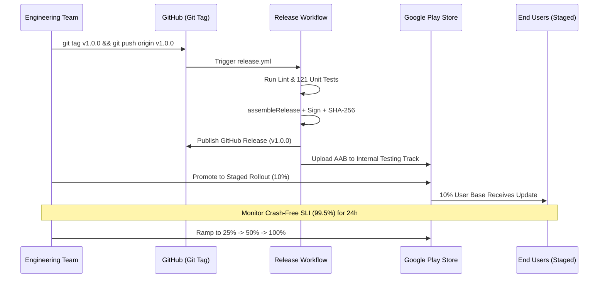

# 92 — Phase 8 Release Delivery & Version Management Workflows

## Release Lifecycle & Staged Rollout Strategy

---

## Semantic Versioning Discipline
Version naming follows Semantic Versioning (`vMAJOR.MINOR.PATCH`):
- `MAJOR`: Fundamental UI overhaul or breaking architectural transformation.
- `MINOR`: New functional capabilities (e.g., IoT weather station support, multi-city tracking).
- `PATCH`: Bug fixes, security hardening, or performance optimizations.

In `app/build.gradle.kts`:
- `versionCode`: Monotonically increasing integer incremented with every production release.
- `versionName`: Semantic version string matching the Git tag.

