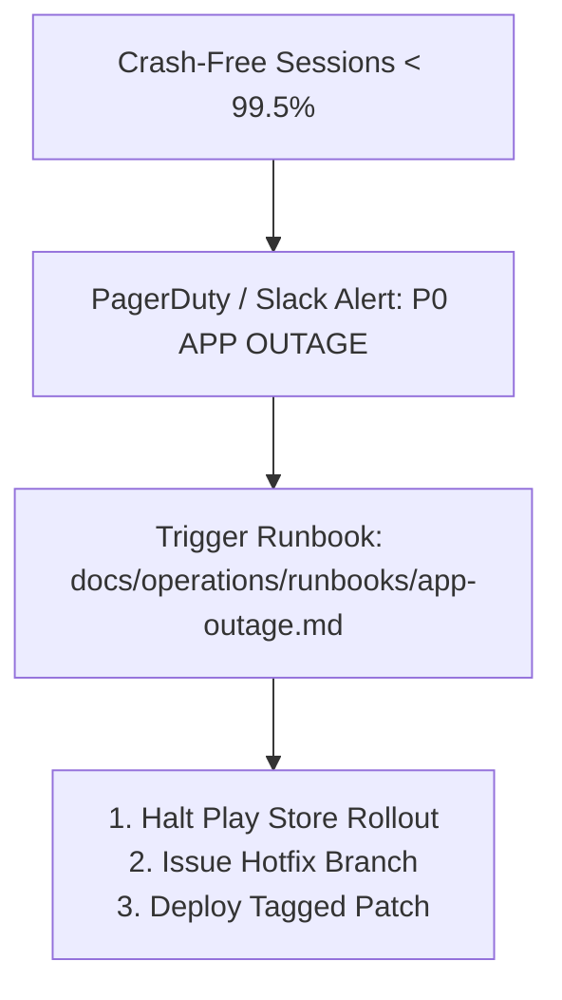

# 97 — Phase 8 Production SLIs, SLOs & Alerting Framework

## Service Level Indicators (SLIs) & Objectives (SLOs)

| Objective Identifier | Indicator (SLI) | Target (SLO) | Measurement Window | Alert Severity |
| :--- | :--- | :--- | :--- | :--- |
| **SLO-OPS-01** | Crash-Free Sessions | >= 99.5% | 24 Hours | P0 (Critical) |
| **SLO-OPS-02** | ANR-Free Sessions | >= 99.8% | 24 Hours | P0 (Critical) |
| **SLO-OPS-03** | Upstream Network Success Rate | >= 95.0% | 1 Hour | P1 (High) |
| **SLO-OPS-04** | Cache Hit Ratio (L1/L2) | >= 80.0% | 1 Hour | P2 (Medium) |
| **SLO-OPS-05** | Circuit Breaker Trip Frequency | <= 5 trips/day | 24 Hours | P2 (Medium) |

---

## Alerting & Escalation Matrix

- **P0 Alerts**: Automated page to on-call mobile release engineer.
- **P1 Alerts**: Notification to `#fomo-ops` Slack channel with circuit breaker metrics.
- **P2 Alerts**: Jira ticket auto-created for next sprint review.

